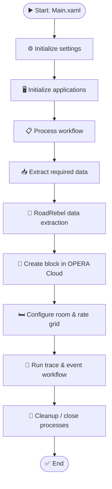

<div align="center">

# 🏨 OPERA Cloud Block Automation

### End-to-end UiPath RPA for hotel block creation & room/rate grid configuration

Automates the **Entertainment Hub block-loading workflow** in **Oracle OPERA Cloud**—from initialization and data extraction through block creation, grid setup, and supporting trace/event steps.


</div>

---

## ✨ Overview

Setting up a hotel block involves multiple steps and application interactions. This project organizes those steps into reusable UiPath workflows to **reduce repetitive manual work, improve process consistency, and make execution easier to maintain**.

### 🎯 What the automation covers

| Workflow area | Purpose |
|---|---|
| ⚙️ **Initialization** | Loads workflow settings and prepares the applications used by the process. |
| 📥 **Data extraction** | Collects information needed for block loading, including the dedicated RoadRebel data-extraction workflow. |
| 🏨 **Block creation** | Runs the block-creation workflow in Oracle OPERA Cloud. |
| 🛏️ **Room & rate grid** | Handles the room and rate grid configuration associated with the block. |
| 📝 **Trace & event** | Runs the supporting trace and event workflow. |
| 🧹 **Framework & cleanup** | Includes transaction-data handling and process cleanup. |

---

## 🔄 High-Level Workflow



> **Note:** This is a high-level view of the workflow areas documented in the project. The exact execution path and required inputs can depend on the environment-specific configuration.

---

## 🧩 Project Structure

```text
OPERA-Cloud-Block-Automation/
├── Main.xaml                         # Workflow entry point
├── 10 Initialization/
│   ├── 10.a InitAllSettings.xaml     # Load workflow settings
│   └── 10.b InitAllApplications.xaml # Prepare applications
├── 20 Processing/
│   ├── 20.a Process.xaml             # Processing orchestration
│   ├── 20.b Extraction.xaml          # Data extraction
│   ├── 20.c Block Creation.xaml      # OPERA Cloud block creation
│   ├── 20.d Room & Rate Grid.xaml    # Room/rate grid setup
│   ├── 20.e Trace & Event.xaml       # Trace/event steps
│   └── 20.f RoadRebel Data Extraction.xaml
├── 30 Framework/
│   ├── 30.a GetTransactionData.xaml  # Transaction-data handling
│   └── 30.c KillAllProcesses.xaml    # Process cleanup
├── project.json                      # Project metadata & dependencies
└── README.md
```

---

## 🛠️ Tech Stack

- **UiPath Studio** — workflow design and execution
- **UiPath Excel Activities** — spreadsheet-related operations where configured
- **UiPath Web API, Mail, Google Workspace & Microsoft 365 activities** — project dependencies for workflows that use them
- **Oracle OPERA Cloud** — target property-management system
- **Visual Basic expressions** — workflow expression language

The project targets **Windows-compatible UiPath workflows**. Project metadata specifies **UiPath Studio 24.10.12**; activity package versions are maintained in `project.json`.

---

## 🚀 Getting Started

### Prerequisites

- UiPath Studio with support for Windows projects and compatibility with the dependencies in `project.json`
- Authorized access to the required Oracle OPERA Cloud environment
- Required input files, application settings, and environment-specific values
- Required UiPath activity packages restored in Studio
- Credentials available through your organization's approved credential-management method

### Run locally

1. 📥 **Clone or download** this repository.
2. 🧩 Open `project.json` in UiPath Studio.
3. 📦 Allow Studio to restore the project dependencies.
4. ⚙️ Review initialization and processing workflows; configure environment-specific settings and input data.
5. 🔐 Confirm that the OPERA Cloud environment and credentials are correct.
6. 🧪 Test with approved data in a non-production environment.
7. ▶️ Run `Main.xaml` to start the workflow.

---

## 🔐 Security & Operational Notes

- Never commit passwords, access tokens, confidential hotel/guest information, or production data to GitHub.
- Use approved credential storage and authorized test environments.
- UI automation can be affected by changes to the OPERA Cloud interface, selectors, permissions, or session state.
- Review workflow outcomes after each test run and follow your organization's exception and incident procedures.
- Confirm the required inputs and runtime configuration with your environment-specific deployment instructions before execution.


---

<div align="center">

**Built with 🤖 UiPath | Designed to streamline hospitality workflows**

</div>
# Movie-Ticket-Booking-System
